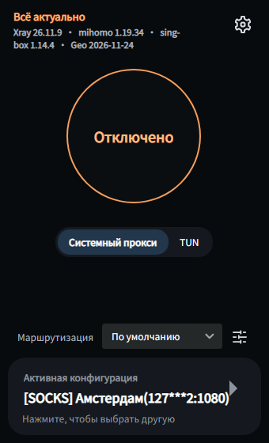
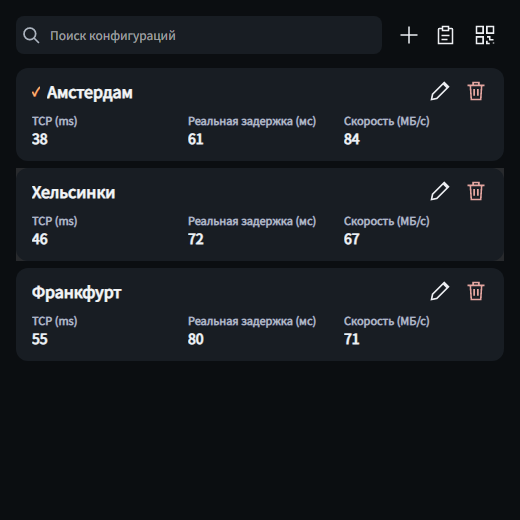
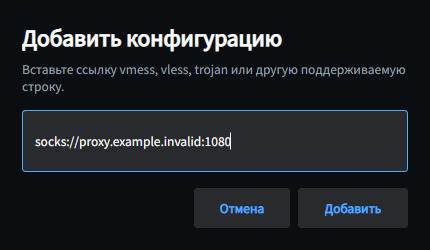

# v2rayN Compact

A fork of v2rayN for Windows and Linux with a compact desktop interface. Pick a configuration, click the large connection button, and use the system tray to connect or disconnect while the window is hidden.

The original client, protocol support, and routing engine come from 2dust and the v2rayN contributors. The Codex AI agent implemented all fork-specific changes, including the new desktop interface. [Original v2rayN repository](https://github.com/2dust/v2rayN)

## Download

| Platform | Portable build | Testing |
| --- | --- | --- |
| Linux x86-64 (amd64) | [Download for Linux (.tar.gz)](https://github.com/kvads/v2rayN-Compact-GUI/releases/latest/download/v2rayN-compact-linux-x64.tar.gz) | Tested on Ubuntu 26.04.1 LTS |
| Windows x64 | [Download for Windows (.zip)](https://github.com/kvads/v2rayN-Compact-GUI/releases/latest/download/v2rayN-compact-windows-x64.zip) | Built only. Untested on Windows. |

**Only the Linux x86-64 build has been tested.** The fork has not been tested on 32-bit x86 or other architectures.

Extract the entire archive into a folder where your account can write. On Linux, open that folder in a terminal and run `./v2rayN`. On Windows, launch `v2rayN.exe`. Both archives include the .NET runtime, Xray, mihomo, sing-box, and geodata. [Release notes](https://github.com/kvads/v2rayN-Compact-GUI/releases/latest) · [SHA-256 checksums](https://github.com/kvads/v2rayN-Compact-GUI/releases/latest/download/SHA256SUMS.txt)

| Main window | Configuration picker |
| --- | --- |
|  |  |

The screenshots show the Russian interface on Linux. The server names and measurements are examples.

## Using the client

1. Click **Active configuration** at the bottom of the main window. Use **＋** to enter a configuration link, the clipboard icon to import a copied configuration, or the QR icon to import a code from an image.
2. Click a configuration name to make it active. A check mark identifies the active entry. Search by name or address. Use the pencil to edit a configuration or the trash icon to delete it. The confirmation shows the configuration name. Click a measurement to run a TCP latency, real delay, or download speed test.
3. Choose **System proxy** or **TUN**, then click the round connection button. System proxy works with apps that follow the operating system’s proxy settings. TUN routes traffic through a virtual network interface and may require administrator privileges. The tray menu can connect or disconnect using the selected mode.
4. Select a **Routing** profile near the bottom of the main window. The button beside the selector opens the routing rules editor. The gear in the upper corner opens the application settings, where you can change the interface language. Restart the client to apply a language change.

<details>
<summary>Entering a configuration link</summary>



</details>

## Updates

**Cores and geodata** can be updated from the main window. The upper-left corner shows the installed Xray, mihomo, and sing-box versions. **Geo** shows the date of the local `geosite.dat` file. When updates are available, click **Install updates**. Right-click the same area to choose components or check for updates manually.

**The desktop client** is distributed separately through this fork’s releases. The in-app updater handles only cores and geodata, so it cannot replace the compact interface with an upstream client build. To update the interface, download a new build from this repository or rebuild from source. New upstream changes can be incorporated into future fork releases. [Fork releases](https://github.com/kvads/v2rayN-Compact-GUI/releases)

## Build from source

Install Git and the .NET 10 SDK, then clone the repository with its submodules. [Download .NET 10 SDK](https://dotnet.microsoft.com/download/dotnet/10.0)

```sh
git clone --recurse-submodules https://github.com/kvads/v2rayN-Compact-GUI.git
cd v2rayN-Compact-GUI
```

**Linux x86-64**

```sh
dotnet publish v2rayN/v2rayN.Desktop/v2rayN.Desktop.csproj -c Release -r linux-x64 --self-contained true -o dist/linux-x64
./dist/linux-x64/v2rayN
```

**Windows x64 (PowerShell)**

```powershell
dotnet publish v2rayN/v2rayN.Windows/v2rayN.Windows.csproj -c Release -r win-x64 --self-contained true -o dist/windows-x64
.\dist\windows-x64\v2rayN.exe
```

These commands build the desktop client. If a core shows a dash in the main window, open the component picker and install the core and geodata you need. Keep the contents of the publish directory together when moving the application.

## Upstream and documentation

This fork is based on upstream commit `91c61b1`. It includes release **7.25.6** and subsequent changes through three commits after the **8.0.1** tag. The client therefore displays **8.0.1** in its title bar. [Base commit](https://github.com/2dust/v2rayN/commit/91c61b1fe595994c7bcf09739ddb5dc32fde4f04) · [Upstream 7.25.6 release](https://github.com/2dust/v2rayN/releases/tag/7.25.6) · [Changes since 8.0.1](https://github.com/2dust/v2rayN/compare/8.0.1...91c61b1fe595994c7bcf09739ddb5dc32fde4f04)

The upstream project maintains the documentation for protocols, cores, and advanced settings. [v2rayN Wiki](https://github.com/2dust/v2rayN/wiki) · [Supported cores](https://github.com/2dust/v2rayN/wiki/List-of-supported-cores) · [Official upstream releases](https://github.com/2dust/v2rayN/releases)

This fork is distributed under the GNU General Public License v3. [License](LICENSE)
